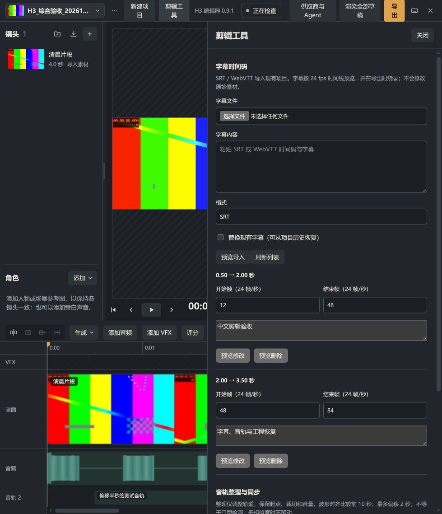
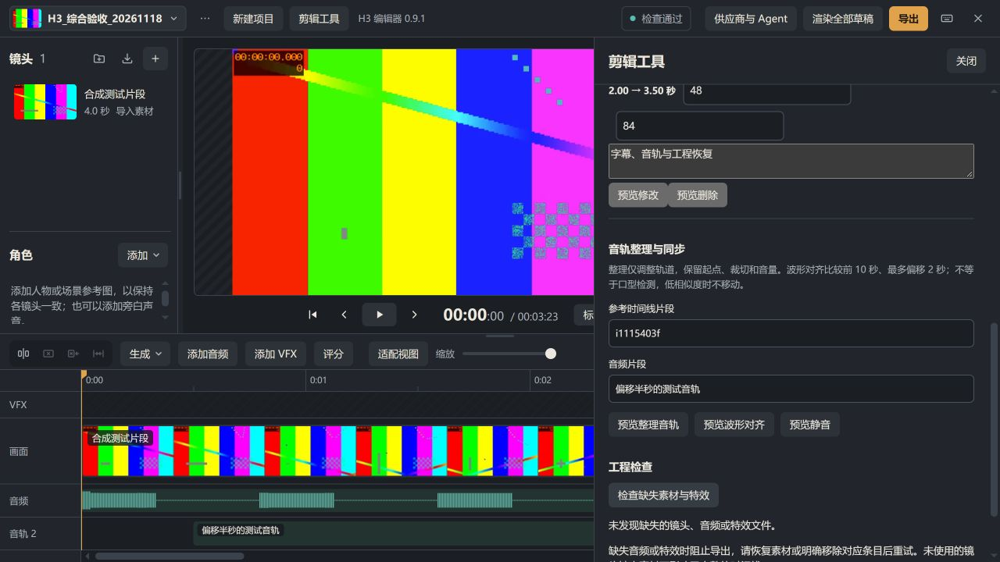
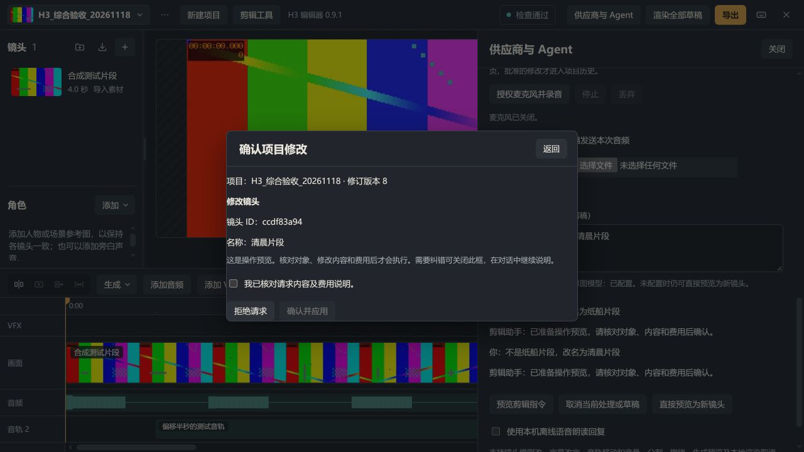
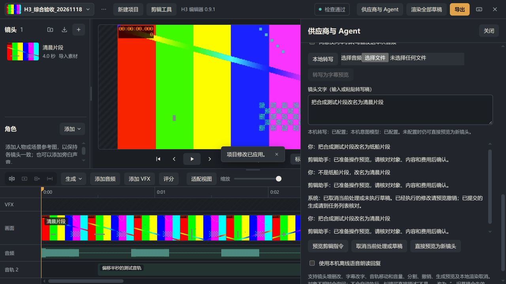

# H3 Editor 剩余改造与分层验收

2026-11-18。代码及可独立完成的验收已实施，**不是全部条件通过**：真实收费 API 尚未调用；本地 H3 未产出 take；麦克风和完整语音识别交互未通过。用户地点中国大陆、仅本人本地使用；未选择中转，按官方协议优先。界面继续使用中文，原 H3 Editor、项目、时间线、take、历史及导出为唯一底座。

## 分层结论

| 验收层 | 结论 | 边界 |
|---|---|---|
| 模拟与契约 | 通过已列测试 | Python 587 项：586 通过、1 跳过；前端 8 项通过；模拟不生成视频 |
| 真实 API | 未调用 | 已获一次方舟 Flash 480p/4 秒/无音频、指定纸船文字、总额 2 元授权；尚缺本机 Key 与账户报价确认。MiniMax、其他规格和中转没有收费测试授权 |
| 实际部署 | 隔离部署通过 | 真实 ComfyUI 0.45.0 加载单份 H3 插件，工作流与媒体回传成功；生产安装没有装入本插件 |
| GPU / 本地 H3 | 未通过渲染 | 单卡 3090 24 GB，系统 RAM 下降触发取消，无 take；另有初始化 CUDA 映射兼容补测 1 项通过，不能替代 H3 生成验收 |
| Agent | 实际 SDK 连接与审批编辑通过；真实生成未通过 | 官方 MCP SDK 2.3.0 → stdio bridge → 真隔离 ComfyUI；生成/取消使用零费用模拟服务 |
| 本地转写 | 进程链路与取消通过；中文质量未通过 | tiny/base 实际转写合成音频，明显错字，须人工纠正；无云端语音调用 |
| 麦克风 | 已授权、已尝试，未验收 | 内置浏览器权限未返回；Chrome 自动化连接超时；未录到音频，不用合成文件冒充麦克风 |
| 成片 | 合成媒体剪辑通过 | 640×352、中文字幕、音轨、分割/叠化实际导出并解码；不是 H3 或付费模型生成成片，未作真人对白/口型/人工听感验收 |

## 需求—实现—测试—结果—证据—剩余问题

证据目录：[20261118](acceptance/20261118/)、[界面截图](acceptance/screenshots/)。未写“通过”的项目不能按已验收宣传。历史交付记录保留在 `DELIVERY.md` / `CHINESE-UI.md`，不把旧环境、旧调用或旧失败替换为当前实测。

| 需求 | 实现位置 | 测试方法 | 结果 | 证据 | 剩余问题 |
|---|---|---|---|---|---|
| 保留已有成果，核对分支/上游 | Git、`NOTICE`、`CHANGELOG.md` | 起点工作树、远端 SHA、上游差异审查 | 已核对 | 起点 `27377d0`，origin/main `0d2e0d1`，上游审查 `391383c`；本地选择性修复 `b7130a0` | 未整体合并上游 0.12.0 的其他功能 |
| H3 原编辑器底座 | `editor/editor.js`、`project.py`、`editor_api.py` | 原回归、真部署中导入与剪辑 | 通过（代码/实际部署） | Python 回归、`actual-editor.json` | 没有复制 MakeMyClip 时间线或另建编辑器 |
| R1 可扩展官方协议 | `provider_adapters.py`、`provider_ark.py` | 官方文档核对、HTTP fixture、模型能力边界 | 通过（契约） | `test_provider_adapters.py`、`test_provider_http.py`、`test_remaining_features.py` | 真实供应商认证/模型资格未实测 |
| R1 供应商/协议/模型/能力配置 | registry、`configured_adapters`、provider 面板 | 配置收窄、未知协议/模型、错误规格、跨协议 ID 拒绝 | 通过（模拟/单元） | 新增契约与前端测试，`PROVIDERS.md` | 中转未选定、未实测，不称通用接口 |
| R1 文生/首帧/参考素材 | `GenerationService`、两适配器 | 空参考、1 张/多张、图像尺寸/路径/哈希；模型下拉框 | 通过（契约/本地 fixture） | `test_remaining_features.py`、前端能力测试 | 视频/音频参考未实现，UI 明示；真实图片生成未调用 |
| R1 生成/进度/取消 | jobs、适配器、UI 状态查询 | 状态机、终态/竞争/限流；实际 Agent 模拟取消 | 通过（模拟/实际 Agent） | `test_provider_jobs.py`、`actual-mcp.json` | MiniMax 无已建立取消契约；方舟 DELETE 有终态删除竞争，自动取消禁用 |
| R1 失败/中断恢复 | SQLite、幂等指纹、reconcile | 提交中断、重启、unknown、核实任务 ID 关联 | 通过（模拟/HTTP fixture） | jobs/HTTP 测试 | 真实不确定提交须先查账户；不自动重发或假定退款 |
| R1 费用预览/预算 | `GenerationService`、jobs、provider review | 报价/图片/版本变化、CNY/USD、已预留账本禁止换币、重复点击 | 通过（模拟/前端） | `test_remaining_features.py`、`provider_panel.test.mjs` | 本地预留不是服务商账单上限；账户价格仍缺 |
| R1 结果进入旧时间线 | `provider_media.py`、bridge | 合成 MP4 暂存、转换、新 take、双 revision、重放/失败清理 | 通过（实际媒体 fixture） | `test_provider_media.py`；真部署媒体导入/导出 | 未获得真实 API 结果，因此真实生成→导入未验收 |
| R2 隔离插件加载 | `.acceptance/ComfyUI`、`prepare.py`、启动脚本 | 真 ComfyUI 0.45.0 启动、日志核对 | 通过（实际部署） | 单份插件加载日志摘录、`actual-editor.json` | 不是生产安装升级后的 H3 插件部署 |
| R2 工作流与媒体回传 | 原 PromptServer/输出路径 | 真 `EmptyImage → SaveImage`、history 与图片输出 | 通过（实际部署） | `actual-editor.json` 的 prompt ID/status/outputs | 这是基础工作流，不是 H3 视频生成 |
| R2 本机 H3 | 原 `start_render/plan_render` | 第二张 3090；256×256、2 秒/56 帧、10 步、无 LoRA | 未通过 | `gpu.json`：57.6 秒，最低系统可用 RAM 3479 MiB，低内存取消，无 take | 需足够 RAM/可合法使用的小编码器投影配置；双卡不合并成单卡 48 GB；不停止用户其他应用 |
| R2 新 ComfyUI 映射兼容 | 上游 pin 修复、`hyperflow.py` | 2 MiB 合成权重，初始化 CUDA/aimdo 后验证不可 pin 的映射 | 通过（实际 CUDA 补测） | `mapped-loading.json`：1/1；普通回归该项仍列跳过 | 不证明 HyperFlow/H3 模型生成质量 |
| R2 保护模型/素材/安装 | 只读模型与基础库引用、独立数据目录 | 对升级备份比较；95 文件 SHA-256、57 模型大小/mtime、生产 Git | 通过（实际本机） | `production-preservation.json`：0 不一致，生产 clean | 权重未做耗时全量重哈希；这是大小/mtime 校验，不伪称逐字节验证 |
| R3 实际 MCP 客户端 | `tools/h3_mcp.py`、`editor_bridge.py` | 官方 SDK 2.3.0 真实 stdio initialize/list/call | 通过（实际 Agent） | `actual-mcp.json` | 未更改用户全局客户端配置 |
| R3 权限/审批/范围 | `editor_security.py`、bridge | 读令牌隐藏写工具、越界拒绝、Agent 自批拒绝、未批执行拒绝、读写令牌不同 | 通过（实际 Agent＋回归） | SDK 只读结果、security/bridge 测试 | 单机受限桥，不开放任意工作流/路径/代码 |
| R3 并发与单次执行 | revision、项目锁、approval owner/content/expiry | 两个真 SDK stdio 客户端同版本提案均经 UI 批准，随后同时执行；重放/旧版本拒绝 | 通过（实际 Agent/单元） | `actual-mcp.json`：9→10 一次提交，另一个 409；concurrent-approved.jpg | 共用令牌的客户端属同一认证身份；多服务器共享一个 SQLite 私有目录不支持 |
| R3 撤销/取消/导出 | bridge restore/provider_cancel/export | 真 SDK 提案→UI 审批→执行、再重放 | 通过（实际 Agent，取消为模拟） | `actual-mcp.json` 的 restore/cancel/export_execute | 已发往供应商的数据和费用无法撤销 |
| R3 生成费用同 UI | 共用 `GenerationService` | 真 SDK 零费用生成预览与 UI 审批、owner 与报价/素材绑定回归 | 通过（模拟/实际 Agent） | `actual-mcp.json`、新增服务测试 | 真 API 及 MCP 本地 H3 产片闭环尚未完成 |
| R4 本地语音转写 | `speech.py`、可选 worker | 实际 synthetic WAV→offline faster-whisper | 链路通过，质量未通过 | `actual-speech-safety.json`、tiny/base revision/hash | 中文有“天家/指傳”等错字，不能视为可可靠直接执行 |
| R4 同意与取消 | ASR 独立同意头、request ID、worker kill | 未同意 409；实际取消长音频；检查临时目录 | 通过（实际本地音频） | `actual-speech-safety.json`：cancel=true、409、temporary_removed=true | 断电/强杀可留系统 TEMP；删除不是安全擦除 |
| R4 麦克风 | `MediaRecorder/getUserMedia` | 授权后尝试浏览器；新增超时/迟到授权回归 | 实机受阻；回归通过（模拟） | 过程记录与前端 timeout/late track 测试 | 浏览器权限未返回、Chrome 控制超时，未录音；不是缺少用户授权 |
| R4 意图预览/执行 | `conversation.py`、`conversation-panel.js` | 真本机 Qwen CPU；聊天改名、预览、确认 | 通过（实际本地模型＋浏览器） | `intent-actual.json`、`actual-chat.json`、chat-applied.jpg | 仅支持声明的意图；未做开放式剪辑全能力承诺 |
| R4 纠错/取消草稿 | previous、过期清理、审批拒绝 | 继续对话改名，旧草稿失效，取消后再明确提交 | 通过（实际浏览器＋回归） | chat-preview/correction/applied 截图、单元测试 | 完整“真实麦克风→准确转写→剪辑”仍未验收 |
| R4 数据留存 | 临时文件、tab 状态、五分钟内存提案、禁提示词日志 | 真取消清理＋idle expiry 测试＋配置核对 | 已实现并部分实测 | ASR 证据、security timer 测试、`PROVIDERS.md` | 本地模型 RAM/KV 缓存保留至覆盖/退出；不能宣称零内存留存 |
| R5 字幕导入/编辑 | `captions.py`、project ops、剪辑工具 | SRT/VTT 时间码、转义、别名、范围裁切、审批与历史、真实烧录 | 通过（单元/实际成片） | `test_remaining_features.py`、`actual-editor.json`、export-frame.png | 每项目最多 300 条；按 24 fps，ASS 烧录；不是完整字幕轨排版器 |
| R5 音轨整理 | `editing_tools.py`、原 sound ops | 四轨打包、保留时间/裁切/增益、超过四重叠拒绝 | 通过（单元） | 新增 tests；真实 UI 已载入 | 不冒充多声源分离或音频修复 |
| R5 音画同步 | 波形相关与已有时间线起点 | 真合成 chirp 偏移半秒→12 帧，阈值/静音/低相关拒绝 | 通过（实际合成媒体/单元） | `actual-editor.json`、`actual-composition.json` | 前 10 秒、±2 秒，非口型识别；人工试听未验收 |
| R5 特效与音频缺失 | health、export_snapshot | 真移走自有测试音频、加入未生成特效，各导出 409，再恢复 | 通过（实际部署） | `actual-speech-safety.json`、`actual-composition.json` | 需恢复素材或明确移除条目后再导出，不静默丢失 |
| R5 分割/转场/合成导出 | 原时间线 + ASS export | 48 帧处分割、6 帧叠化、字幕/混音、解码；并发导出原子预留、失败清理 | 通过（实际成片） | `actual-composition.json`、`final-deployment-smoke.json`：两个独立 89 帧成片；[合成示例](acceptance/20261118/composition-synthetic.mp4) | 纯合成测试，不声称 AI 产片或真人听感通过 |
| R5 工程归档恢复 | 原 archive/retarget/history | 真 keep=all ZIP→新项目，核对字幕/音轨与原 revision | 通过（实际部署） | `actual-editor.json`、恢复后的 `_2` 成片 | 崩溃时项目/历史的跨文件原子性仍依上游，备份必要 |
| R5 中文界面一致 | 原 UI + 两侧工具面板 + ui-zh | 真界面截图、中文输入/名称、展示和内容边界测试 | 主要流程通过（实际浏览器/前端） | editing-tools.jpg、chat 截图、UI tests | 模型 ID、用户文本、文件路径与未知第三方元数据保持原值 |
| R6 密钥与凭据 | 环境、DPAPI 脚本、私有 ACL、脱敏 | 配置/响应/日志边界回归，实际 MCP 私有文件 ACL | 通过已列自查/测试 | 原 security/transport/HTTP tests、私有 ACL 核对 | 用户尚未配置真实 Key，DPAPI 真实 Key 注入未验收；不提交私有目录 |
| R6 URL/下载/媒体风险 | SafeHTTPS、暂存、media 输入限制 | DNS/特殊地址/redirect/超时/无 CDN Key；真本机 HLS 计数服务器 | 通过（攻击性 fixture） | transport/HTTP/media tests；HLS 外部取片计数 0 | 原本机 ComfyUI 其他插件/服务不等于本轮安全边界；不宣称全机安全 |
| R6 编辑器/依赖/模型/服务许可 | NOTICE、分层许可清单 | 本地许可文件/wheel 元数据、官方条款与用户地域 | 已核对指定范围，非全面签署 | `LICENSE-REVIEW-20261118.md`、dependency-licenses.json | 未选中转、账号资格/报价、小投影权重许可仍是条件 |
| R7 可复现与证据 | `tools/acceptance/`、复现文档、矩阵 | 独立脚本、原始结果、截图/合成成片 | 已交付 | `REPRODUCE-20261118.md`、本目录证据 | 未测项明确保留；没有用测试数量替代缺失实测 |

## 生产与上游边界

工作起点 `feature/provider-foundation` / `27377d0` 干净；审查上游 `391383c`（0.12.0），相对原基线 43 文件改变。只选入 `6d5ad8e` 的映射 pin 修复，冲突时只保留该修复的 changelog，不把其依赖的未合入新功能列为已实现。保留已有中文/Windows LoRA/provider 成果。

生产 ComfyUI 已在前序授权升级至 0.45.0，当前 Git `989d93d0d968e704c589ce0146bb18c77f6b50cc`、clean；备份 `G:/ComfyUI_backups/before-0.45.0-20261118-083845`。本轮隔离验证后，57 模型大小/mtime 与备份一致，95 个既有输入/输出/用户/节点文件哈希一致。无主分支合并、Release 或生产 H3 安装覆盖。

## 当前仍缺的条件

1. 方舟 Key 由用户在本机隐藏输入配置、账号已开通目标模型，并确认实际单次报价 ≤2 元；已有一次测试授权，不重复索取授权、不充值。当前真实服务配置保持关闭。
2. 能正常返回麦克风权限且可录音的浏览器连接；10 秒测试授权已获，实际声音和完整语音交互仍未通过。
3. 能容纳本地 H3 的系统内存/合法小编码器投影配置。现有 32B 方案已实际触发低内存取消，不通过停止用户应用、合并双卡容量或私自下载许可不明投影“完成”验收。
4. 若以后选择中转或更换模型/素材/追加预算，应先补充其官方协议、价格、隐私/许可及对应实测，不能沿用本次纸船授权。

必要截图：

