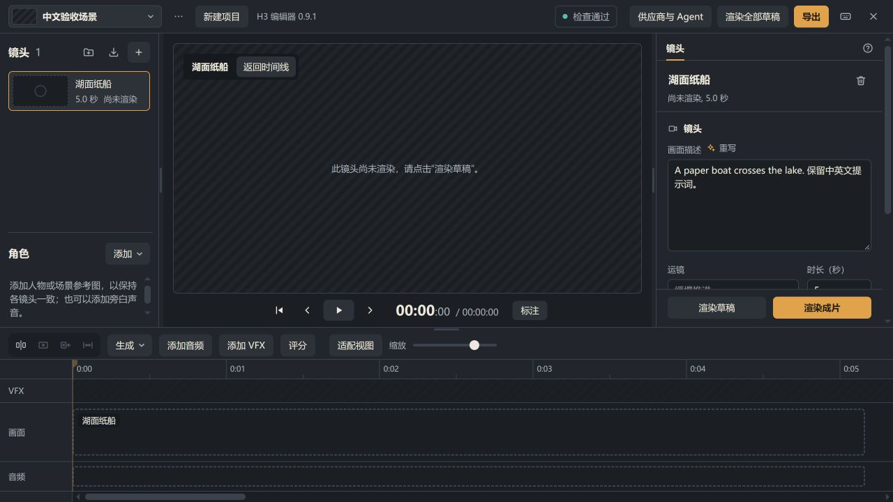
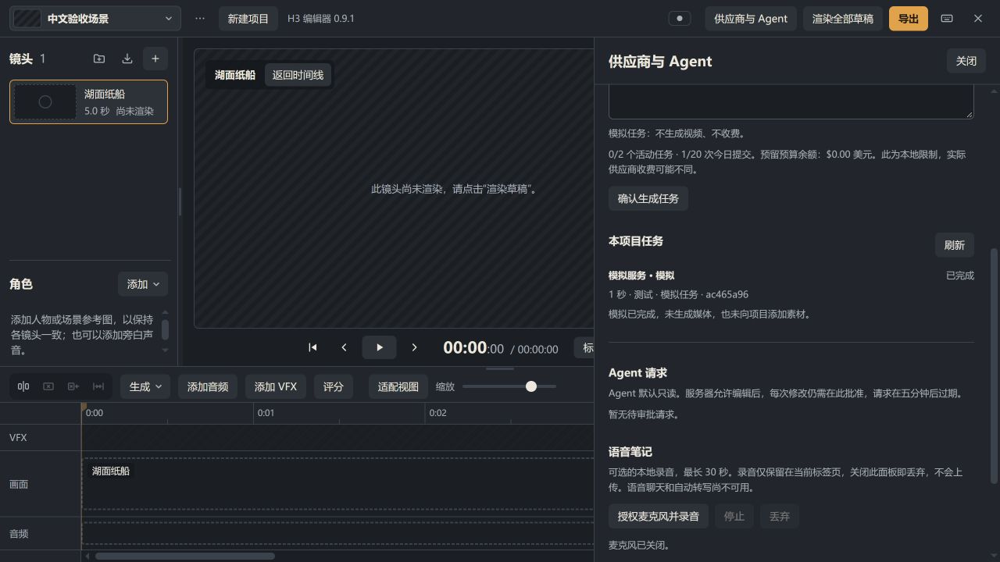
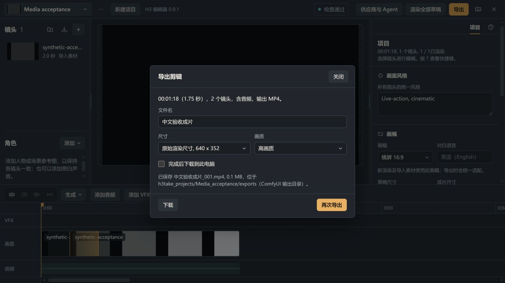
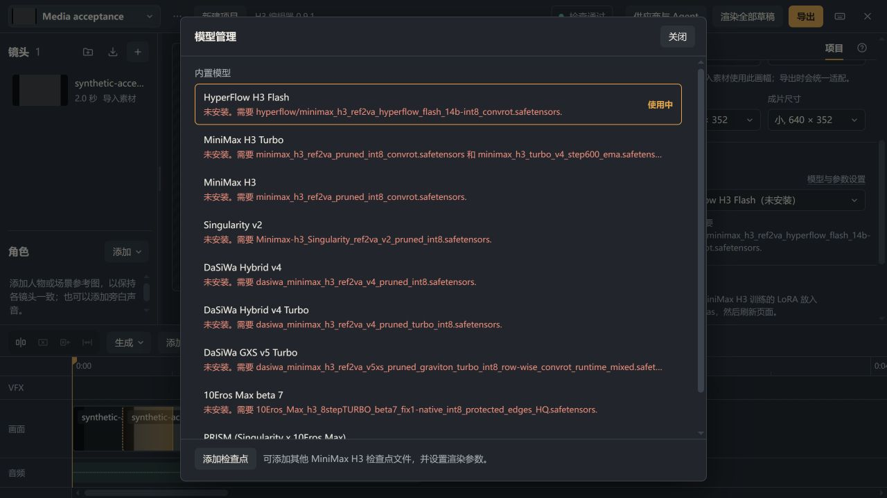
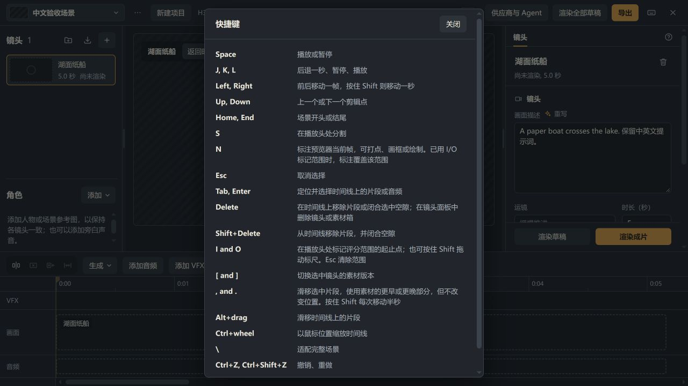

# 简体中文界面

2026-11-18，沿用原编辑器布局和配色，默认使用简体中文。

- 中文覆盖项目菜单、镜头与角色、素材版本、时间线、模型设置、智能写作、标注、导出、快捷键，以及供应商任务、费用确认、Agent 审批和语音笔记控件。
- `lang="zh-CN"`，加入 Windows 微软雅黑字体回退；状态、单位、日期和主要空状态/错误提示使用中文。
- 支持纯中文项目名称、文件夹及导出文件名。既有英文项目无需改名；中文名称仍经过同一受限字符和长度校验。
- 模型 ID、文件路径、接口字段、HTTP 方法、快捷键键码、存储键和用户输入保持原值。模型写作协议提示词仍按原协议发送。第三方原始报错、用户内容及未知插件元数据可能保留原文。

## 验收

全部在仓库的隔离 HTTP 验收环境执行；没有部署到现有 ComfyUI，也没有执行真实供应商付费生成。

| 检查 | 结果 |
|---|---|
| Python 回归 | 565/565 通过，0 跳过；新增中文名称安全校验、HTTP 创建/保存/重开及 ZIP 媒体路径测试 |
| 前端功能测试 | 6/6 通过，覆盖确认前不提交、重复点击、价格/时长约束、转写稿预览及中文展示边界 |
| 基线对照 | 472 个 HTML 元素的结构/功能属性不变；685 处快捷键、选择器、DOM ID、存储键、接口和写作提示词字面量不变 |
| 浏览器 | 1280×720：纯中文项目创建、镜头编辑、刷新重开、中英文提示词保留、模拟任务确认/完成、MiniMax 禁用说明、模型设置、快捷键弹窗 |
| 操作/导出 | Delete 移除时间线片段后 Ctrl+Z 恢复；合成测试素材成功导出 `中文验收成片_001.mp4`，640×352，1.75 秒 |
| 静态设计检查 | 提示动态图片无初始 src 和默认标题字号层级；页面截图已核验，保留原编辑器设计。静态工具无法解析运行时挂载的 CSS URL，未将其作为完整视觉验收 |

浏览器验收首先按本机规则尝试 Jev 官方直连，但首次目标选择请求返回 API 错误，页面动作未执行。未自动重试，后续由 Codex 接手。该次请求账本保留 0.002688 美元未知费用预留，实际扣费未确认；估算使用本机当日价格参考，官方文档当时无法连接。此为界面辅助决策调用，与 MiniMax 生成无关。

